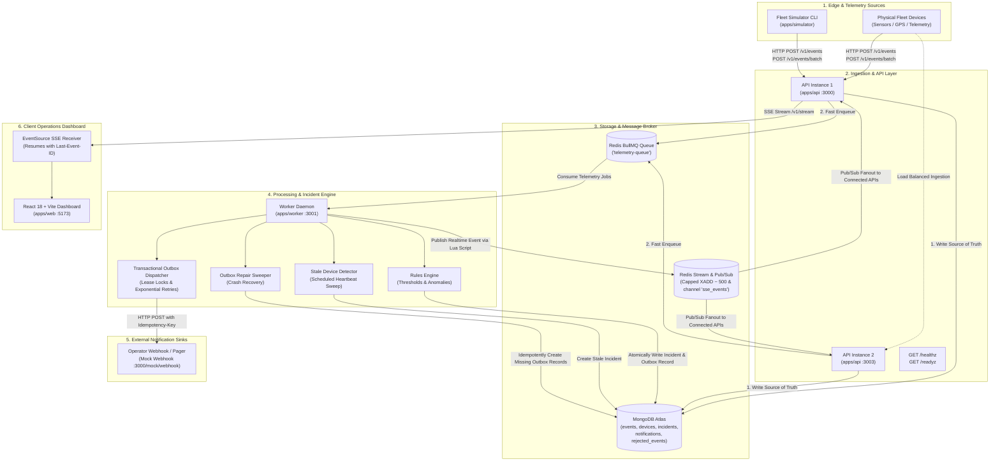
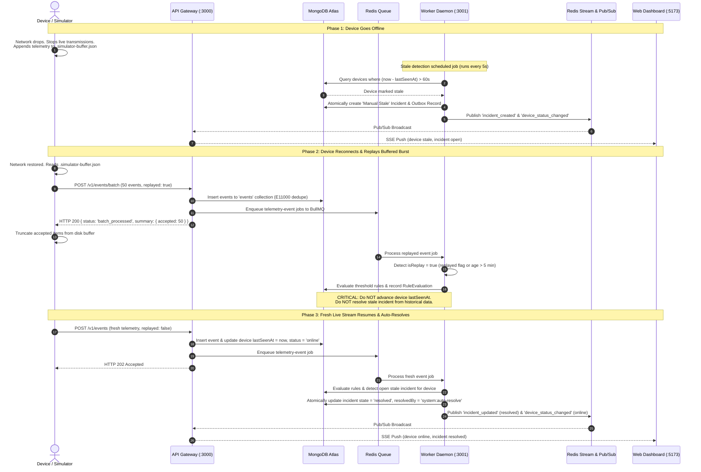

# Architecture Blueprint: Real-Time Fleet Operations Platform

## 1. System Vision & Overview

The **Real-Time Fleet Operations Platform** is an enterprise-grade, event-driven operations system designed to ingest high-frequency IoT telemetry, evaluate operational alert rules, manage incident lifecycles, and fan out live stream updates to a mission-control web dashboard.

The architecture emphasizes:
- **Decoupled Ingestion**: Fast HTTP edge ingestion decoupled from database writes via asynchronous Redis queueing.
- **Authoritative Deduplication**: MongoDB unique constraints provide durable at-least-once to exactly-once idempotency.
- **Transactional Outbox**: Atomic database transactions guarantee zero notification loss during worker crashes.
- **Observable Stream Fanout**: Capped Redis Streams combined with Redis Pub/Sub power resilient Server-Sent Events (SSE) with `Last-Event-ID` resumption.

---

## 2. End-to-End System Architecture

---

## 3. Offline Disconnection, Replay, and Auto-Resolution Sequence

When a device loses connectivity, it buffers events locally to memory and disk (`.simulator-buffer.json`). The platform detects the absence of heartbeats, triggers a stale device incident, processes historical batch replays without false status updates, and automatically resolves incidents once fresh live events resume.

---

## 4. Pipeline Component Specifications

### 4.1 Ingestion API Gateway (`apps/api`)
- **Fast Ingestion Validation**: Validates telemetry payloads with Zod (`telemetryEventSchema` and `batchEventsSchema`).
- **Deduplication Gatekeeper**: Inserts directly to MongoDB `events` collection. Catches duplicate key error `E11000` on `eventId` and returns HTTP 200 `status: "duplicate"` with zero side effects.
- **Backpressure & Throttling**:
  - Rejects incoming traffic with HTTP 429 `code: "queue_full"` when BullMQ queue depth exceeds `MAX_QUEUE_DEPTH`.
  - Enforces per-device rate limiting (`rate_limited`) with `Retry-After`.
- **Realtime SSE Gateway**: Exposes `GET /v1/stream` with native `Last-Event-ID` header support, 15-second heartbeat comments, and client connection tracking.

### 4.2 Background Worker Daemon (`apps/worker`)
- **BullMQ Telemetry Consumer**: Processes telemetry jobs at controlled concurrency (`WORKER_CONCURRENCY: 5`), isolating write load from ingestion spikes.
- **Rules Engine (`rulesEngine.ts`)**: Evaluates `threshold`, `type_match`, and `no_report` rules with optional cooldown suppression windows. Writes explainability records to `rule_evaluations` (with a 24-hour TTL index).
- **Incident Manager (`incidentManager.ts`)**: Atomically creates and updates incidents with single-incident guarantees via MongoDB partial unique index on `{ dedupeKey: 1, state: { $in: ['open', 'acknowledged'] } }`.
- **Transactional Outbox (`notificationDispatcher.ts`)**: Dispatches notifications to operator webhooks using atomic leases (`lockedUntil`) and exponential backoff with jitter, marking notifications `dead` after reaching `MAX_NOTIFY_ATTEMPTS`.
- **Outbox Repair Sweeper**: Periodic sweep (at startup and every 60s) finding orphaned open incidents and repairing missing notification records idempotently.

### 4.3 Operations Mission Control Dashboard (`apps/web`)
- **Vite 6 + React 18**: Low-latency SPA consuming SSE streams and status REST endpoints.
- **Resilient Connection Handling**: Visual banner (`connected`, `reconnecting`, `offline`). Reconnects automatically using native `EventSource`. On receiving `resync_required`, transparently refetches REST snapshots.
- **Optimistic UI Updates**: Instant incident acknowledgment and resolution with automatic rollback on error.

### 4.4 Fleet Simulator CLI (`apps/simulator`)
- Single-file lightweight CLI supporting steady, burst, offline replay, and chaos scenarios.
- Caches authenticated device keys to `.simulator-keys.json` and buffers offline telemetry to `.simulator-buffer.json`.
