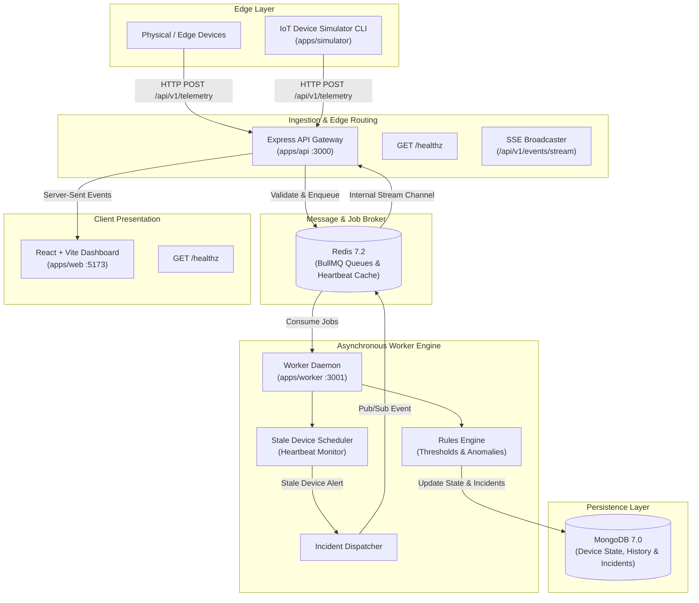

# Architecture Overview: Real-Time Operations Platform

## 1. System Vision & Objective

The **Real-Time Operations Platform** is an enterprise-grade, event-driven monitoring system designed for device fleet telemetry management, rules evaluation, incident orchestration, and live visualization.

The design philosophy prioritizes **operational reliability, predictable latency, fault tolerance, and comprehensive observability** over unnecessary distributed complexity.

---

## 2. High-Level Architecture Diagram



---

## 3. Monorepo Structure

```text
├── apps/
│   ├── api/             # Express API: Ingestion, REST, SSE Live Stream
│   ├── worker/          # BullMQ background worker: Rule evaluation & stale scheduler
│   ├── web/             # React + Vite operational mission-control dashboard
│   └── simulator/       # Device fleet telemetry simulator CLI
├── packages/
│   ├── config/          # Centralized Zod-validated environment config
│   └── logger/          # Pino structured JSON logger with Correlation IDs
├── docs/
│   ├── ARCHITECTURE.md  # System architecture & component blueprint
│   ├── DECISIONS.md     # Architecture Decision Records (ADRs)
│   └── DEPLOYMENT.md    # Deployment, runbooks, and verification guide
├── docker-compose.yml   # Multi-service container orchestration
└── package.json         # Root npm workspaces manifest
```

---

## 4. Core Component Responsibilities

### 4.1 Ingestion API Gateway (`apps/api`)
- **Fast Ingestion**: Validates telemetry payloads against strict schemas, appends metadata (server timestamp, ingestion correlation ID), and immediately enqueues jobs to Redis. Returns `202 Accepted` to minimize connection hold time.
- **REST APIs**: Provides endpoints to inspect device state, query historical incidents, and manage rule policies.
- **SSE Stream**: Maintains persistent HTTP connections for web dashboard clients, streaming device metric snapshots and incident events with zero client polling.
- **Health Probing**: Exposes `/healthz` for container orchestration and uptime monitoring.

### 4.2 Background Worker Daemon (`apps/worker`)
- **Decoupled Processing**: Consumes telemetry batches asynchronously from BullMQ queues, isolating the ingestion API from database write spikes.
- **Rules Engine**: Evaluates metrics against dynamic operational thresholds (CPU usage, memory pressure, battery level, error rates).
- **Stale Device Scheduler**: Periodically scans device heartbeats. If a device fails to report within `STALE_DEVICE_THRESHOLD_SECONDS`, an incident is triggered.
- **Incident Dispatcher**: Emits incident notifications to Redis Pub/Sub, which routes them to the SSE broadcaster.
- **Dedicated Health Server**: Hosts a lightweight HTTP health endpoint (`:3001/healthz`) to verify worker liveliness.

### 4.3 Operations Mission Control (`apps/web`)
- **React 18 + Vite**: High-performance dashboard rendering fleet metrics, device cards, active alerts, and incident logs.
- **Live Stream Receiver**: Subscribes to `/api/v1/events/stream` via native `EventSource`, automatically recovering from temporary disconnects.
- **Health Verification**: Exposes `/healthz` via Vite development and preview middleware.

### 4.4 Device Simulator CLI (`apps/simulator`)
- Generates synthetic telemetry for customizable fleet sizes (`--devices`) and emission frequencies (`--interval`).
- Implements simulated network anomalies (stale drops, intermittent CPU spikes) to test rule evaluation.

---

## 5. Reliability, Security & Fault-Tolerance Guarantees

1. **MongoDB-Driven Deduplication (Source of Truth)**: Event deduplication relies on MongoDB's unique index on `eventId` (`events` collection, created at startup). Duplicate inserts trigger `E11000` and return `"Duplicate event, already received"`. Redis caching is strictly an optional fast-path populated only *after* successful persistence.
2. **Persistence First & Enqueue Reliability**: Every accepted event is saved to MongoDB with `processingStatus: "pending"`, `receivedAt` (server time), and `timestamp` (device time) before BullMQ enqueueing. If queue enqueueing fails, HTTP `503 Service Unavailable` is returned while the record remains safely stored for recovery sweeps.
3. **Rejected Events Audit Trail**: All rejected events (schema violations, type errors, broken JSON) are stored in the `rejected_events` collection with raw payload, deviceId, reason, and receivedAt timestamp.
4. **Credential Security (SHA-256 Hashing)**: API keys are hashed with SHA-256 before persistence in MongoDB. Redis caches device IDs by key hash (`device_key:<hash>`) rather than plaintext.
5. **Two-Tier Backpressure & Rate Limiting**:
   - **Queue Depth Backpressure**: If BullMQ waiting + delayed jobs exceed `MAX_QUEUE_DEPTH` (default 5000), requests are rejected with `429 Too Many Requests`, header `Retry-After: 2`, and response code `"queue_full"`.
   - **Per-Device Rate Limiting**: Requests exceeding rate limits return `429 Too Many Requests` with response code `"rate_limited"`.
   - **Burst Batch Ingestion**: `/v1/events/batch` utilizes a dedicated, higher rate limit counted per request to accommodate reconnection bursts.
6. **Graceful Shutdown**: Traps `SIGINT`/`SIGTERM` to drain active HTTP requests, pause queue consumers, and close database connections cleanly.

---

## 6. Observability & Distributed Tracing

- **Structured JSON Logging**: Built with `pino` for microsecond-level performance and standard JSON formatting.
- **Correlation IDs**: Every incoming request is stamped with `x-correlation-id` (propagated from upstream or generated via UUIDv4).
- **Asynchronous Context Tracing**: Node.js `AsyncLocalStorage` seamlessly binds correlation IDs across nested asynchronous function calls, ensuring every log statement includes the active trace context.
- **Health Checks**: Standardized `/healthz` endpoints across API, Worker, and Web services providing uptime, timestamp, and environment metadata.
