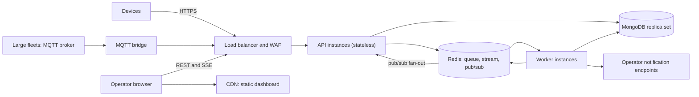

# Deployment Notes

This document explains how the platform would be deployed, monitored and scaled for a real client. It separates what exists in this repository from what is proposed, so nothing here should be read as already built unless it says so.

| Label | Meaning |
| :--- | :--- |
| **Implemented** | Present in the code and used in the local setup |
| **Proposed** | A recommended production step that is not built or tested here |

---

## 1. Running locally (Implemented)

The tested path is plain Node.js with a MongoDB Atlas database and a Redis Cloud database. Setup, demos and tests are in the [README](../README.md). A `docker-compose.yml` is included for convenience, but the native path is the one that was exercised during development.

Key settings (the full list is in `.env.example`, which is the authority):

| Variable | Purpose |
| :--- | :--- |
| `MONGO_URL` | MongoDB connection string |
| `REDIS_URL` | Redis connection URL (`rediss://` for TLS) |
| `API_PORT`, `WORKER_HEALTH_PORT`, `WEB_PORT` | Service ports |
| `CORS_ORIGIN` | Allowed dashboard origin(s) |
| `MAX_QUEUE_DEPTH` | Queue backlog at which ingestion returns `429 queue_full` |
| `MAX_NOTIFY_ATTEMPTS` | Delivery attempts before a notification becomes `dead` |
| `AUTO_RESOLVE_STALE` | Whether a fresh event auto-resolves a stale incident |
| `DASHBOARD_TOKEN` | Optional token for dashboard endpoints (off by default) |
| `LOG_LEVEL` | Log verbosity |

---

## 2. Target production architecture (Proposed)



**Why this shape:** ingestion is separated from processing by a queue, so a traffic spike fills the queue and does not slow the API. The API holds no state except open SSE connections, and the worker is safe to run in several copies, so both scale by adding instances.

---

## 3. Components and how each scales

| Component | Behavior | Scaling approach |
| :--- | :--- | :--- |
| **API** | Stateless. Holds open SSE connections. Fans out realtime messages through Redis pub/sub, so any number of instances work. | Scale on CPU and on open connections behind the load balancer. |
| **Worker** | Consumes the queue. Idempotent, so extra copies are safe. The stale-device scan is one repeatable job, so only one copy runs it at a time. Notification delivery claims work with a lease, so two copies never send the same notification. | Scale on queue depth (section 8). |
| **MongoDB** | Source of truth for events, incidents, notifications and rules. | Replica set first. Shard by `deviceId` if write volume outgrows one primary. |
| **Redis** | BullMQ queue, capped SSE stream, pub/sub, counters and rate limits. | One primary with a replica and automatic failover (see section 4). |
| **Dashboard** | Static files. | Serve from a CDN. |

**Capacity.** No load test was run, so no throughput figure is claimed. To size a deployment, estimate events per second as devices divided by the reporting interval, then load-test the three stages that scale differently: API ingestion (one Mongo insert plus one enqueue per event), worker processing (rule evaluation and writes), and SSE fan-out (one stream per open dashboard). The 500-event burst and the flood in the acceptance suite are the largest loads exercised.

---

## 4. Data stores

### MongoDB
- Use a managed service (for example MongoDB Atlas, M10 or larger) as a three-node replica set across availability zones, with TLS and encryption at rest.
- Continuous backups with point-in-time recovery.
- **Indexes are created at application startup** in this repository. In production, create them through a controlled migration step so a rollout never builds a large index while serving traffic. The important ones are the unique index on `events.eventId`, the partial unique index on `incidents.dedupeKey`, and the unique index on `notifications.incidentId`.
- **Retention is a gap.** `rule_evaluations` expires after 24 hours, but `events`, `incidents` and `notifications` grow without limit. A real client needs a retention policy, for example a TTL index on old events or archival to object storage.

### Redis
- Set the eviction policy to **`noeviction`**. BullMQ keeps queue state in Redis, and an eviction policy that deletes keys can lose jobs.
- Enable persistence (AOF every second, or snapshots) and a replica with automatic failover.
- BullMQ does not work with Redis Cluster unless the queue name carries a hash tag, so the simplest deployment is a single primary with a replica rather than a sharded cluster.
- Memory is bounded by design: completed jobs are limited to the last 100 and failed jobs to the last 500, and the realtime stream is trimmed to roughly 500 messages.
- Redis holds queue state and a recent-message window, not the system of record. Losing it should cost in-flight jobs and the SSE history, not events: the recovery sweep re-queues any stored but unprocessed event from MongoDB.

---

## 5. Load balancer and realtime stream

Server-Sent Events are long-lived HTTP responses, so the proxy must not buffer them or close them early.

- The API sends a heartbeat comment every 15 seconds, so the connection is never idle for long. Set the load balancer idle timeout comfortably above that (for example 60 seconds); a very long timeout is not needed.
- Turn proxy response buffering off for `/v1/stream`. The API already sends `X-Accel-Buffering: no`.
- Enable HTTP/2 on the public listener so several dashboard tabs do not hit the browser's per-host HTTP/1.1 connection limit.

```nginx
location /v1/stream {
    proxy_pass http://api_upstream;
    proxy_http_version 1.1;
    proxy_set_header Connection "";
    proxy_buffering off;
    proxy_cache off;
    proxy_read_timeout 3600s;
}
```

- **Routing:** the simplest setup serves the dashboard and the API under one domain (for example `/` to the CDN and `/v1` to the API). That avoids cross-origin configuration. If they are on separate domains, set `CORS_ORIGIN` on the API.
- **Reconnects after a deploy:** when API instances restart, dashboards reconnect with `Last-Event-ID` and receive what they missed, or receive `resync_required` and reload their data.

---

## 6. Security and access (Proposed)

| Area | Current state | For a real client |
| :--- | :--- | :--- |
| **Device identity** | A per-device API key, stored hashed. Registration is open. A lost key cannot be recovered. | Close open registration and provision devices through an authenticated admin flow. Add key rotation and revocation. For large fleets use mutual TLS or short-lived tokens issued by an IoT gateway. |
| **Operator access** | Dashboard endpoints have no login (an optional shared token exists). | Single sign-on (OIDC) with role-based access: view, acknowledge and resolve, and administer rules. Record the operator on every acknowledge and resolve. |
| **Edge protection** | Per-device rate limits and a queue-depth limit. | Add a WAF and IP-level rate limiting in front of the API, since per-device limits do not cover unauthenticated traffic. |
| **Secrets** | `.env` locally, ignored by git. | A secrets manager (AWS Secrets Manager, Vault, or Kubernetes secrets with an external operator), injected as environment variables at start. |
| **Network** | Databases allow access from anywhere in the demo setup. | Private networking or VPC peering, with the databases reachable only from the API and worker. |
| **Notification endpoints** | A mock webhook. Each delivery carries an `Idempotency-Key`. | Sign webhook requests and use an allow-list of destinations. |

---

## 7. Build, release and rollout (Proposed)

- Package the API and the worker as separate container images so they scale and deploy independently. Serve the dashboard from object storage behind a CDN, and make `/index.html` the fallback for unknown paths.
- Run on a container platform (AWS ECS on Fargate, or Kubernetes). Use `/readyz` as the readiness check and `/healthz` as the liveness check.
- Roll out gradually. The services shut down gracefully on `SIGTERM`: the API stops accepting connections and the worker finishes or releases its jobs, and anything left unfinished is picked up by stalled-job recovery and the sweeps.
- Because processing is idempotent and devices resend unacknowledged events, a rolling restart does not lose events.
- Run the automated suite (`npm test`) against a staging environment before promoting a release. It needs a running stack and writes test data, so it must not point at production.

---

## 8. Monitoring and alerting

### What exists today (Implemented)

- Structured JSON logs with `eventId`, `deviceId`, `incidentId` and a correlation ID at each stage.
- `GET /healthz` and `GET /readyz` on the API and the worker.
- `GET /v1/stats`: events per minute, devices by status, open incidents by severity, queue depth, failed jobs, duplicate and rejected counts, notification counts and connected SSE clients.
- Investigation endpoints: `GET /v1/events/:id/evaluations`, `GET /v1/admin/failed-events`, `GET /v1/admin/rejected-events`.

### What is missing (Proposed)

There is **no `/metrics` endpoint** yet. A production deployment would add one (for example with `prom-client`), ship the JSON logs to a central store (CloudWatch, Loki or similar), and build dashboards and alerts on top. Until a metrics endpoint exists, `/v1/stats` and `/readyz` can be polled by an external monitor.

Suggested metrics:

| Metric | Why |
| :--- | :--- |
| Events received, duplicate, rejected (counters) | Traffic shape and bad-device detection |
| Queue waiting and active jobs (gauges) | Backlog and autoscaling signal |
| Processing duration (histogram) | Time from ingestion to processed |
| Incidents created (counter) | Rule behavior and alert storms |
| Notifications failed and dead (counters) | Delivery health |
| Connected SSE clients (gauge) | Capacity of the API tier |

### Suggested alerts

| Condition | Severity | Likely cause |
| :--- | :--- | :--- |
| `/readyz` failing on any instance for several minutes | High | Database or queue unreachable |
| Queue backlog above a threshold (for example 1,000) for 3 minutes | High | Workers too few, or crash-looping |
| Ingestion returning `429 queue_full` | High | Processing cannot keep up |
| Any notification reaching `dead` | High | An operator was not told about an incident |
| Failed events (`/v1/admin/failed-events`) growing | Medium | A bug or a bad payload shape |
| Sustained spike in rejected events from one device | Warning | A misconfigured or rogue device |
| Dashboard SSE clients dropping to zero while devices send | Warning | Stream or proxy problem |
| Time from ingestion to processed above target | Warning | Worker or database slowness |

Useful service-level targets: ingestion availability, the time from an event arriving to its incident being visible, and the delay before a notification is first attempted.

---

## 9. Autoscaling (Proposed)

Scale workers on queue depth, not on CPU, because a backlog is what users feel. With Kubernetes and KEDA:

```yaml
apiVersion: keda.sh/v1alpha1
kind: ScaledObject
metadata:
  name: fleet-worker
spec:
  scaleTargetRef:
    name: fleet-worker
  minReplicaCount: 2
  maxReplicaCount: 20
  triggers:
    - type: redis
      metadata:
        address: <redis-host>:<port>
        listName: bull:telemetry-queue:wait
        listLength: "500"
```

Confirm the queue name and key prefix in the code before using this. On ECS the equivalent is a scaling policy driven by a queue-depth metric.

Scale the API on CPU and open connections. Keep at least two instances of each service for availability.

### When the current design stops being enough

| Symptom | Next step |
| :--- | :--- |
| Very large fleets (tens of thousands of devices) make per-request HTTP expensive | Put an MQTT broker (AWS IoT Core, EMQX or HiveMQ) at the edge. The bridge should send events through the ingestion API, or reuse its code, so that the insert-first deduplication still applies. Writing straight into the queue would skip it. |
| Strict per-device processing order is required | Partition work by `deviceId`, for example with per-device queue groups or a Kafka topic keyed by device. The current design does not guarantee per-device order. |
| MongoDB write throughput saturates a single primary | Shard by `deviceId` and move old events to cheaper storage. |
| One Redis primary becomes the bottleneck | Split the roles: a dedicated instance for the queue, another for the stream, pub/sub and rate limits. |

---

## 10. Backup, recovery and multi-region

- **Backups:** continuous MongoDB backups with point-in-time recovery, and periodic restore drills. Redis is rebuildable from MongoDB (see section 4), so its backup matters less.
- **Single region:** run across at least two availability zones with automatic failover for both databases.
- **Multi-region (active-passive):** keep a standby API and worker tier in a second region, with a MongoDB cross-region replica. Fail over DNS on health-check failure and promote the replica.
- **What happens to clients on failover:** the realtime stream history lives in Redis and is regional, so after a failover dashboards receive `resync_required` and reload from the REST endpoints. Devices that cannot reach the platform keep their events buffered and replay them in order afterwards. The replay flag stops that burst from resolving stale incidents wrongly.
- Set explicit recovery objectives with the client. The data-loss window is bounded by the MongoDB replication lag to the standby region.

---

## 11. Gaps to close before going live

These are repeated from [LIMITATIONS.md](LIMITATIONS.md) because they matter most in production:

1. Close open device registration, and add key rotation and revocation.
2. Add operator login and roles for the dashboard.
3. Add a `/metrics` endpoint, central log shipping and the alerts above.
4. Define data retention for events, incidents and notifications.
5. Run a load test to find real throughput limits before sizing the platform.
6. Test behavior when Redis or MongoDB fails during operation (only start-up failure was checked).
7. Move index creation out of application start-up into a migration step.
